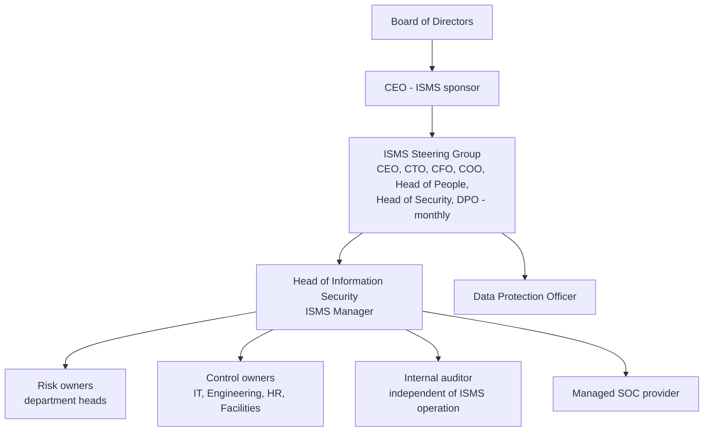

# 01 - Company Profile

> **Simulated organization.** Halcyon Ledger Inc. is fictional. Any resemblance to a real company is coincidental.

Halcyon Ledger sells **HalcyonPay**, a cloud platform that automates supplier invoice processing and payouts for mid-market businesses. Three enterprise deals worth **$4.2m ARR** are stalled pending ISO/IEC 27001 certification. That is the board's main reason for this project.

| Attribute | Detail |
| --- | --- |
| Legal entity | Halcyon Ledger Inc., founded 2017 |
| Service | HalcyonPay: invoice capture (OCR), approval workflows, supplier onboarding, bank payouts through a licensed bank partner |
| Customers | 1,400 business customers across the US; 38,000 end users |
| Revenue | $38m ARR |
| People | 210 staff: 95 Engineering, 30 Customer Success, 25 Sales & Marketing, 20 Finance & Ops, 15 Product, 10 IT & Security, 15 G&A; plus 22 contractors |
| Sites | Head office in Austin, Texas (140 staff); engineering hub in Raleigh, North Carolina (60); 10 fully remote |
| Hosting | AWS us-east-1 (N. Virginia) primary, us-west-2 (Oregon) disaster recovery; Kubernetes (EKS), PostgreSQL (RDS), S3 |
| Corporate IT | Microsoft 365, Okta SSO, Jamf and Intune for endpoints, GitHub, Jira, Salesforce, Zendesk, Slack |
| Key data | Supplier bank details, invoices, customer contact data, payment instructions; about 2.1m payments a year |
| Payment cards | Not stored; subscription card payments are fully outsourced to Stripe |
| Starting point | NIST CSF self-assessment; SOC 2 Type I (2025); no formal ISMS; one Head of Security and two security engineers |

## ISMS governance

| Role | Responsibility |
| --- | --- |
| CEO (top management) | Approves policy, objectives, SoA and residual risk; chairs management review (Clause 5.1) |
| ISMS Steering Group | Directs the program, tracks risk treatment, allocates resources |
| ISMS Manager | Runs the ISMS day to day: risk process, documentation, KPIs, audit program |
| Risk owners | Accept and fund treatment of the risks in their area |
| Control owners | Operate controls and produce evidence |
| Internal auditor | Plans and runs audits; reports to the CEO to stay independent (Clause 9.2) |
