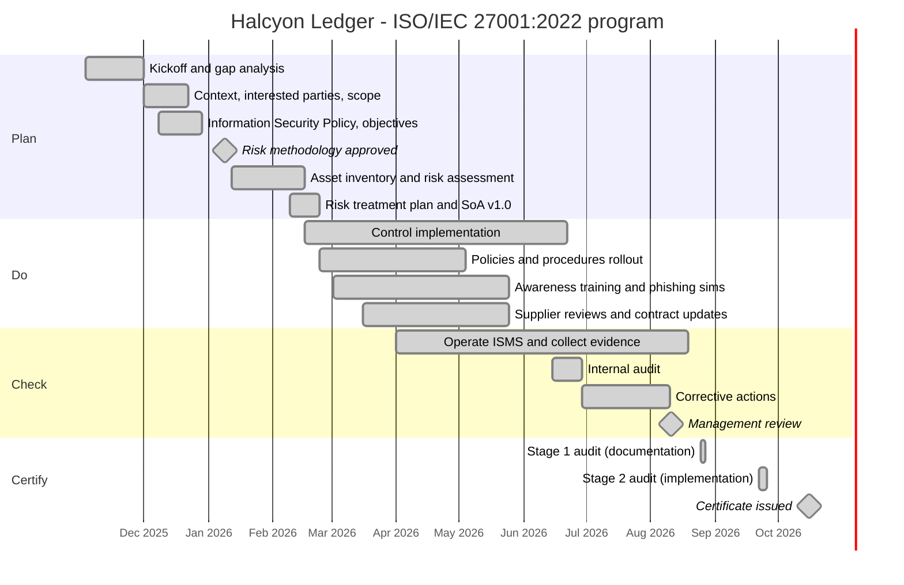

# 02 - Implementation Roadmap

The ISMS went from kickoff to certificate in **11 months** (November 2025 to October 2026). The plan follows the Plan-Do-Check-Act cycle: build the foundations, run a risk-driven control program, operate long enough to produce evidence, then audit and review before the certification body arrives.

## Phase deliverables

| Phase | Key deliverables | ISO/IEC 27001 clauses | Exit gate |
| --- | --- | --- | --- |
| 0. Gap analysis | Gap report against all clauses and 93 controls; project charter; budget ($310k) | 4-10, Annex A | CEO approves charter |
| 1. Foundations | [Scope](03-isms-scope.md), [context register](04-context-and-interested-parties.md), policy, objectives, roles | 4.1-4.4, 5.1-5.3, 6.2 | Steering Group sign-off |
| 2. Risk | [Methodology](05-risk-assessment-methodology.md), asset inventory, [risk register and treatment plan](06-risk-register-and-treatment-plan.md), [SoA](07-statement-of-applicability.md) | 6.1, 8.2, 8.3 | Risk owners accept residual risk |
| 3. Implement | Controls, 14 topic-specific policies, training, supplier contracts | 7.1-7.5, 8.1, Annex A | All Critical and High risks treated |
| 4. Operate and check | KPI dashboard, [internal audit](08-internal-audit-checklist.md), corrective actions | 9.1, 9.2, 10.2 | No open major nonconformities |
| 5. Review and certify | [Management review](09-management-review-report.md), Stage 1 and Stage 2 audits | 9.3, 10.1 | Certificate issued |

## Mandatory documented information produced

| Clause | Document | Where in this case study |
| --- | --- | --- |
| 4.3 | ISMS scope | [03-isms-scope.md](03-isms-scope.md) |
| 5.2 | Information security policy | Summarised in [03-isms-scope.md](03-isms-scope.md#information-security-policy-summary) |
| 6.1.2 | Risk assessment process | [05-risk-assessment-methodology.md](05-risk-assessment-methodology.md) |
| 6.1.3 | Risk treatment process and Statement of Applicability | [06](06-risk-register-and-treatment-plan.md), [07](07-statement-of-applicability.md) |
| 6.2 | Information security objectives | [09-management-review-report.md](09-management-review-report.md#3-information-security-objectives-clause-62) |
| 7.2 | Evidence of competence | Training records (referenced in audit) |
| 8.2, 8.3 | Risk assessment and treatment results | [06-risk-register-and-treatment-plan.md](06-risk-register-and-treatment-plan.md) |
| 9.1 | Monitoring and measurement results | [09-management-review-report.md](09-management-review-report.md) |
| 9.2 | Audit program and results | [08-internal-audit-checklist.md](08-internal-audit-checklist.md) |
| 9.3 | Management review results | [09-management-review-report.md](09-management-review-report.md) |
| 10.2 | Nonconformities and corrective actions | [08](08-internal-audit-checklist.md#5-findings-and-corrective-actions), [09](09-management-review-report.md) |
