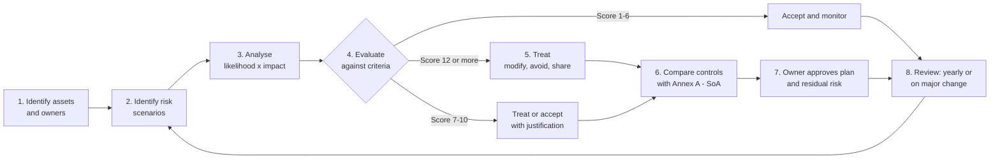

# 05 - Risk Assessment Methodology (Clause 6.1.2)

> **Document ID:** ISMS-RAM-001 · **Version:** 1.0 · **Owner:** ISMS Manager · **Approved by:** CEO on 9 January 2026 · **Classification:** Internal

Halcyon uses an **asset-and-scenario based** method, scored on a **5x5 likelihood × impact matrix** and aligned with ISO/IEC 27005:2022. Any risk scoring **12 or more must be treated**. Risks scoring **1-6 may be accepted** by the risk owner.

## Process

1. **Identify assets** in scope: information, systems, people, suppliers and sites. Each has an owner (Annex A 5.9 inventory).
2. **Identify risk scenarios.** A scenario is a threat exploiting a vulnerability to harm the confidentiality, integrity or availability of an asset. Sources include the [context register](04-context-and-interested-parties.md), threat intelligence, past incidents and audit findings.
3. **Analyse.** Score likelihood and impact against the controls in place today. Halcyon scores current risk, not a theoretical no-controls score, so the results reflect reality.
4. **Evaluate** each score against the acceptance criteria below.
5. **Treat.** Choose to modify, avoid, share or retain the risk, then select controls.
6. **Compare with Annex A** to make sure no necessary control has been missed (Clause 6.1.3 c). Record the result in the [Statement of Applicability](07-statement-of-applicability.md).
7. **Approve.** The risk owner signs off the treatment plan and accepts the residual risk (Clause 6.1.3 f).
8. **Review.** Run a full reassessment every 12 months, and also after a major change, a serious incident or a new regulation (Clause 8.2).

## Likelihood scale

| Score | Level | Definition |
| --- | --- | --- |
| 1 | Rare | Less than once in 10 years; no known occurrence in the sector |
| 2 | Unlikely | Once in 3-10 years |
| 3 | Possible | Once in 1-3 years; has happened to peers |
| 4 | Likely | Once or more a year |
| 5 | Almost certain | Several times a year, or already happening |

## Impact scale (the highest applicable column sets the score)

| Score | Level | Financial | Customers and service | Legal and regulatory | Reputation |
| --- | --- | --- | --- | --- | --- |
| 1 | Negligible | < $10k | Outage < 1 hour; no data affected | None | No external awareness |
| 2 | Minor | $10k-$100k | Outage 1-4 hours; < 10 customers affected | Minor contract breach | Local customer complaints |
| 3 | Moderate | $100k-$500k | Outage 4-24 hours; < 100 customers | Reportable state-law breach, no fine | Trade press coverage |
| 4 | Major | $500k-$2m | Outage 1-3 days; data of > 100 customers exposed | Regulatory investigation; partner breach notice | National press; key customers leave |
| 5 | Severe | > $2m | Outage > 3 days; mass payment fraud | Fine or loss of the bank partnership | Lasting brand damage; threat to the business |

## Risk matrix (score = likelihood × impact)

| Likelihood \ Impact | 1 Negligible | 2 Minor | 3 Moderate | 4 Major | 5 Severe |
| --- | :---: | :---: | :---: | :---: | :---: |
| **5 Almost certain** | 🟩 5 | 🟨 10 | 🟥 15 | 🟥 20 | 🟥 25 |
| **4 Likely** | 🟩 4 | 🟨 8 | 🟧 12 | 🟥 16 | 🟥 20 |
| **3 Possible** | 🟩 3 | 🟩 6 | 🟨 9 | 🟧 12 | 🟥 15 |
| **2 Unlikely** | 🟩 2 | 🟩 4 | 🟩 6 | 🟨 8 | 🟨 10 |
| **1 Rare** | 🟩 1 | 🟩 2 | 🟩 3 | 🟩 4 | 🟩 5 |

## Risk acceptance criteria

| Score | Rating | Action required | Who can accept |
| --- | --- | --- | --- |
| 15-25 | 🟥 Critical | Treat immediately; plan within 30 days; report to the board | CEO only, with notice to the board |
| 12-14 | 🟧 High | Treat within 90 days | Executive risk owner (C-level) |
| 7-10 | 🟨 Medium | Treat within 6 months, or accept with written justification | Department head |
| 1-6 | 🟩 Low | Accept and monitor | Risk owner |

## Why the results are consistent, valid and comparable (Clause 6.1.2 b)

- Each scale uses measurable thresholds ($, hours, customer counts) rather than words like "high", so two assessors scoring the same scenario should land within one point of each other.
- The ISMS Manager facilitates every assessment, so the method is applied the same way each time.
- Scores are recorded in the GRC tool with their rationale, so a reassessment can be compared line by line with the previous one.
